<picture>
  <source media="(prefers-color-scheme: dark)" srcset="assets/neofetch-dark.svg" />
  
</picture>

React and React Native developer based in Kathmandu, Nepal. Three-plus years building web and mobile products with React, React Native, and Expo, with TypeScript and Node.js behind them.

I've worked with software companies in Lalitpur (Margintop Solutions and Probits, since 2024) and with freelance clients in Nepal and Australia: offline field apps used across all 77 districts of Nepal, community apps on Google Play and the App Store, and dashboards teams use every day.

I work solo, on purpose. When you hire me, you talk to the person writing your code: no account managers, no hand-offs. Available for freelance work worldwide.

**[Portfolio](https://developer-portfolio.jagatgurung30.workers.dev)** · [sushankgurung2002@gmail.com](mailto:sushankgurung2002@gmail.com) · [LinkedIn](https://www.linkedin.com/in/sushank-gurung/)

<table>
<tr>
<td valign="top" width="50%">

### work

**[MDESK](https://mdesk.margintopsolutions.com.np/)** — Institute SaaS: inquiries, courses, fees, phone-first live attendance. Web and mobile.

**[Oripari](https://oripari.com.au)** — Rooms, jobs, events for Nepalis in Australia. Cross-platform React Native app. 21k+ users. [Play](https://play.google.com/store/apps/details?id=com.probits.oripari) · [App Store](https://apps.apple.com/np/app/oripari/id6737851096)

**[Mr. Valuator](https://mrvaluator.com)** — Offline field valuation across 77 districts; admin exports 100+ bank formats. [App Store](https://apps.apple.com/np/app/mr-valuator/id6761289671) · [Field app](https://github.com/cHANGTEEZY/evaluation_employee)

**[Clinical Talent Australia](https://clinicaltalent.com.au/en)** — Healthcare staffing: admin, web, and mobile app.

**[Heart to Help](https://hearttohelp.com.au)** — Sydney NDIS provider web app. Next.js.

</td>
<td valign="top" width="50%">

### repos

**[CPipe](https://github.com/cHANGTEEZY/CPipe)** — Real-time Kanban. Convex, RBAC, optimistic drag-and-drop.

**[receipt-rival-api](https://github.com/cHANGTEEZY/receipt-rival-api)** — Hono / Bun API on [Vercel](https://receipt-rival-api.vercel.app).

**[hono-api-boiler-plate](https://github.com/cHANGTEEZY/hono-api-boiler-plate)** — Auth, Drizzle, OpenAPI, Docker starter.

**[pocket-habit](https://github.com/cHANGTEEZY/pocket-habit)** — Expo habit tracker (Bloom) + PocketBase.

**[CV-Manager](https://github.com/cHANGTEEZY/CV-Manager)** — ATS: interviews, letters, S3. [Live](https://cv-manager-rose.vercel.app)

**[neovim-config-ctz](https://github.com/cHANGTEEZY/neovim-config-ctz)** — Kickstart Neovim for TypeScript and Go.

**[cachyos-dotfiles](https://github.com/cHANGTEEZY/cachyos-dotfiles)** — Hyprland setup on CachyOS.

</td>
</tr>
</table>

### what I do

**Build** — new web and mobile products with React, React Native, and Expo, from idea to release.
**Improve** — React Native / Expo upgrades, performance tuning, codebase stabilization, and feature work on existing apps.

How I work: discovery → design → build → ship, and I stay in the thread after release.

### contact

[sushankgurung2002@gmail.com](mailto:sushankgurung2002@gmail.com) · [Portfolio](https://developer-portfolio.jagatgurung30.workers.dev) — freelance as fixed-price or hourly. Async from Nepal time (UTC+5:45).

