<picture>
  <source media="(prefers-color-scheme: dark)" srcset="assets/terminal-dark.svg" />
  <source media="(prefers-color-scheme: light)" srcset="assets/terminal-light.svg" />
  
</picture>

 

I build web apps, admin dashboards and mobile clients, and I usually own the whole slice: UI, auth, API, schema and deploy. About two years at Margintop Solutions, two years freelancing, and I run [VBEE Studio](https://vbee.sushankgurung.com), a small React and React Native team in Kathmandu.

[Email](mailto:jagatgurung30@gmail.com) &nbsp;/&nbsp; [LinkedIn](https://www.linkedin.com/in/sushank-gurung) &nbsp;/&nbsp; [VBEE Studio](https://vbee.sushankgurung.com) &nbsp;/&nbsp; Lalitpur, Nepal (UTC+5:45)

---

### Shipped

| | | |
| --- | --- | --- |
| **[Oripari](https://oripari.com.au)** | Rooms, jobs, events and chat for Nepalis in Australia. 21,000+ users on [Play](https://play.google.com/store/apps/details?id=com.probits.oripari) and the [App Store](https://apps.apple.com/au/app/oripari/id6737851096). | React Native, Firebase |
| **[MDESK](https://mdesk.net)** | Institute management SaaS: inquiries, courses, fees and phone-first live attendance. | Next.js, React, TanStack |
| **[Mr. Valuator](https://mrvaluator.com)** | Offline-first property valuation across all 77 districts of Nepal, with 100+ bank-specific report formats. | Expo, SQLite sync, Refine, Better Auth |
| **[Clinical Talent](https://clinicaltalent.com.au/en)** | Site and staffing dashboard for an Australian healthcare agency. | Next.js, React |
| **[Heart to Help](https://hearttohelp.com.au)** | Site for a Sydney NDIS provider with booking, hiring and feedback flows. | Next.js |

### Open source

- **[CPipe](https://github.com/cHANGTEEZY/CPipe)** is a multi-workspace Kanban with roles, live activity logs and optimistic drag-and-drop on Convex.
- **[receipt-rival-api](https://github.com/cHANGTEEZY/receipt-rival-api)** is the typed REST API behind ReceiptRival, built on Bun, Hono, Drizzle and Postgres.
- **[hono-api-boiler-plate](https://github.com/cHANGTEEZY/hono-api-boiler-plate)** is the API starter I reuse, with auth, migrations, rate limits, OpenAPI docs and Docker.
- **[CV-Manager](https://github.com/cHANGTEEZY/CV-Manager)** tracks applicants for HR teams, from interviews to offer letters.
- **[pocket-habit](https://github.com/cHANGTEEZY/pocket-habit)** is an Expo habit tracker with schedules and streaks.

### Stack

### Desk

CachyOS with Hyprland ([dotfiles](https://github.com/cHANGTEEZY/cachyos-dotfiles)) and Neovim ([config](https://github.com/cHANGTEEZY/neovim-config-ctz)). Most days are TypeScript, with more Go creeping in.

 

<picture>
  <source media="(prefers-color-scheme: dark)" srcset="https://raw.githubusercontent.com/cHANGTEEZY/cHANGTEEZY/output/github-contribution-grid-snake-dark.svg" />
  <source media="(prefers-color-scheme: light)" srcset="https://raw.githubusercontent.com/cHANGTEEZY/cHANGTEEZY/output/github-contribution-grid-snake.svg" />
  
</picture>

Open to freelance work, fixed-price or hourly. Write to <a href="mailto:jagatgurung30@gmail.com">jagatgurung30@gmail.com</a>.
