<picture>
  <source media="(prefers-color-scheme: dark)" srcset="assets/neofetch-dark.svg" />
  
</picture>

Full stack and React Native developer. Three-plus years shipping production web apps, admin dashboards, and mobile clients — about two years at Margintop Solutions, two years freelance, and founder of [VBEE Studio](https://vbee.sushankgurung.com).

At Margintop I work on institute SaaS, healthcare staffing, and Oripari. Admin dashboards across the company start from a shared React system I built. Freelance and VBEE Studio — a five-person React / React Native team in Kathmandu — cover client products.

[jagatgurung30@gmail.com](mailto:jagatgurung30@gmail.com) · [LinkedIn](https://www.linkedin.com/in/sushank-gurung) · [VBEE Studio](https://vbee.sushankgurung.com)

<table>
<tr>
<td valign="top" width="50%">

### work

**[MDESK](https://mdesk.net)** — Institute SaaS: inquiries, courses, fees, phone-first live attendance. Next.js + React dashboard.

**[Oripari](https://oripari.com.au)** — Rooms, jobs, events for Nepalis in Australia. React Native. 21k+ users. [Play](https://play.google.com/store/apps/details?id=com.probits.oripari) · [App Store](https://apps.apple.com/au/app/oripari/id6737851096)

**[Mr. Valuator](https://mrvaluator.com)** — Offline field valuation across 77 districts; admin exports 100+ bank formats. [Field app](https://github.com/cHANGTEEZY/evaluation_employee)

**[Clinical Talent](https://clinicaltalent.com.au/en)** — Healthcare staffing site and dashboard. Next.js.

**[Heart to Help](https://hearttohelp.com.au)** — Sydney NDIS provider site. Next.js.

</td>
<td valign="top" width="50%">

### repos

**[CPipe](https://github.com/cHANGTEEZY/CPipe)** — Real-time Kanban. Convex, RBAC, optimistic drag-and-drop.

**[receipt-rival-api](https://github.com/cHANGTEEZY/receipt-rival-api)** — Hono / Bun API on [Vercel](https://receipt-rival-api.vercel.app).

**[hono-api-boiler-plate](https://github.com/cHANGTEEZY/hono-api-boiler-plate)** — Auth, Drizzle, OpenAPI, Docker starter.

**[pocket-habit](https://github.com/cHANGTEEZY/pocket-habit)** — Expo habit tracker (Bloom) + PocketBase.

**[CV-Manager](https://github.com/cHANGTEEZY/CV-Manager)** — ATS: interviews, letters, S3. [Live](https://cv-manager-rose.vercel.app)

**[neovim-config-ctz](https://github.com/cHANGTEEZY/neovim-config-ctz)** — Kickstart Neovim for TypeScript and Go.

**[cachyos-dotfiles](https://github.com/cHANGTEEZY/cachyos-dotfiles)** — Hyprland setup on CachyOS.

</td>
</tr>
</table>

### contact

[jagatgurung30@gmail.com](mailto:jagatgurung30@gmail.com) — freelance as fixed-price or hourly. Async from Nepal time (UTC+5:45).

<picture>
  <source media="(prefers-color-scheme: dark)" srcset="assets/contrib-snake-dark.svg" />
  
</picture>
